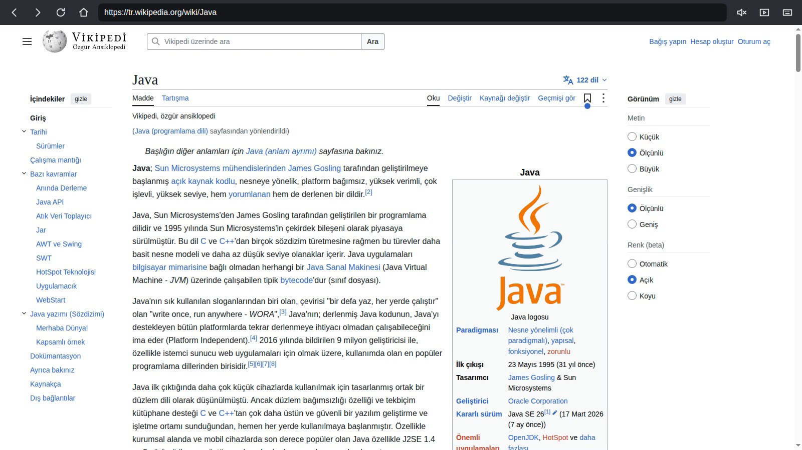

# Porthole

**Browse the modern web on old iPads and iPhones.** Porthole runs a real, current Chromium on your
server and streams it to the browser on your device. Your device only shows the picture and sends
taps, scrolls and typing back, so even an iPad 2 on iOS 9 can use sites its Safari gave up on years
ago: YouTube, modern web apps, anything that needs a recent browser.

It is a self-hosted alternative to Browservice, built around touch devices: real on-screen keyboard
input, momentum scrolling, sound, and a native video player for YouTube and other video sites.



## Features

- **Works on Safari 9 (iOS 9).** The client is plain ES5 with no build step, and has been tested on
  an iPad 2 with iOS 9.3.5.
- **Touch-first.** Taps become clicks, swipes scroll with momentum, and the iOS keyboard opens when a
  text field on the page is focused.
- **Sharp picture.** Old devices get JPEG frames while you scroll and a lossless PNG as soon as you
  stop. Browsers with WebCodecs (current Chrome, Edge, Safari, Firefox) get a live H.264 stream at
  30 fps instead, which stays sharp while scrolling.
- **Sound.** Page audio is streamed alongside the picture; tap the speaker button to turn it on.
- **Video mode.** On a page with a video, the video button hands it to
  [yt-dlp](https://github.com/yt-dlp/yt-dlp) and plays it in the device's own player as HLS. On old
  iPads that means hardware-decoded H.264 instead of a slideshow.
- **Persistent profile.** Cookies and logins survive restarts, and your logins carry over to video
  mode.
- **Popups and new tabs** open in place.
- **English and Turkish interface** (`UI_LANG`).

## How it works

```
 device (Safari 9, any browser)            server (Docker)
 ┌─────────────────────────┐   WebSocket   ┌──────────────────────────────────────────┐
 │ index.html + app.js     │ ◄──frames──── │ server.js ── CDP ──► Chromium (kiosk,    │
 │   or <canvas>      │ ───input────► │   │                   Xvfb + openbox)    │
 │  Web Audio  ◄───────────┼── /audio ──── │ audio.js ◄─ ffmpeg ◄─ PulseAudio sink    │
 │  <video> (HLS) ◄────────┼── /video ──── │ video.js ◄─ ffmpeg ◄─ yt-dlp             │
 └─────────────────────────┘               │ vstream.js ◄─ ffmpeg x11grab (H.264)     │
                                           └──────────────────────────────────────────┘
```

Playwright drives Chromium over the Chrome DevTools Protocol. Old browsers get the page from
`Page.startScreencast` (JPEG) plus `Page.captureScreenshot` (PNG) when the page settles. Browsers
with WebCodecs get the screen captured by ffmpeg and encoded with x264 in zero-latency mode, one
frame per WebSocket message. Everything goes over HTTPS and WebSockets, so it works behind
Cloudflare Tunnel and similar proxies that do not carry UDP.

## Quick start

You need a Linux server with Docker. 2 vCPUs and 2 GB of RAM are enough for one user.

```sh
mkdir porthole && cd porthole
curl -fsSLO https://raw.githubusercontent.com/furkaanasik/porthole/main/docker-compose.yml
mkdir data && sudo chown 1001:1001 data   # the container runs as uid 1001
docker compose up -d
```

Porthole now listens on `http://127.0.0.1:8090`. **Do not expose it to the internet without
authentication** (see [Security](#security)). Put it behind an authenticating reverse proxy, such as
Cloudflare Tunnel with Cloudflare Access, then open that address on your device. On an iPad, use
*Share → Add to Home Screen* for a full-screen app.

### Recommended: block ads at DNS level

On a small server, ad and tracker scripts are what make pages slow. Porthole can use the
[StevenBlack hosts list](https://github.com/StevenBlack/hosts) as its `/etc/hosts`:

```sh
curl -fsSL https://raw.githubusercontent.com/StevenBlack/hosts/master/hosts -o blocklist.hosts
```

Then uncomment the `blocklist.hosts` line in `docker-compose.yml` and run `docker compose up -d`.
On our 2-vCPU test server this cut scroll handling on ad-heavy sites from about 700 ms to about
30 ms.

### Building the image yourself

```sh
git clone https://github.com/furkaanasik/porthole.git && cd porthole
docker build -t ghcr.io/furkaanasik/porthole:latest .
```

The image downloads the newest yt-dlp release at build time. If a video site stops working,
rebuild with `docker build --no-cache` (or pull a newer image).

## Configuration

Set these in the `environment` section of `docker-compose.yml`.

| Variable | Default | Description |
| --- | --- | --- |
| `UI_LANG` | `en` | Interface language: `en` or `tr`. |
| `LOCALE` | `en-US` | The browser's language, which sites use to localize. |
| `TZ` | `UTC` | The browser's time zone, e.g. `Europe/Berlin`. |
| `HOME_URL` | `https://duckduckgo.com/` | Home page. |
| `SEARCH_URL` | `https://duckduckgo.com/?q=` | Search URL; the query is appended. |
| `QUALITY` | `60` | JPEG quality while scrolling (frame mode). |
| `IDLE_QUALITY` | `85` | JPEG quality when idle or with HD on (frame mode). |
| `MAX_WIDTH` | `1920` | Widest viewport, in CSS pixels. |
| `VIDEO_FPS` | `30` | Frame rate of the H.264 stream. |
| `VIDEO_CRF` | `21` | x264 quality of the H.264 stream; lower is sharper and larger. |
| `VIDEO_PRESET` | `superfast` | x264 preset; `ultrafast` uses less CPU. |
| `DEBUG` | | Set to `1` to log every message and frame statistics. |

Add `?frames` to the address to force frame mode in a browser that supports H.264.

## Security

Porthole has **no login of its own**. Anyone who can open it controls a browser that is logged into
your accounts, and that runs inside your server's network. Always put authentication in front of
it. Cloudflare Access, Authelia, Authentik, oauth2-proxy and basic auth on a reverse proxy all work.
The only file that may be public is `/icon.png`, which iOS fetches for the home-screen icon without
cookies.

The included `docker-compose.yml` binds to `127.0.0.1` only, so the port is never reachable from
outside the server itself.

## Limitations

- **One session at a time.** A second device that connects takes over, and the first sees a "tap
  to take it back" message. Everyone shares one browser profile.
- **No DRM video.** Netflix, Disney+ and similar need Widevine, which this Chromium does not have.
  Protected video would show as black anyway.
- **CPU.** One user on 2 vCPUs is comfortable. The H.264 stream uses about half a core while
  scrolling and very little when the page is still.
- **amd64 only** for the published image.

## Development

```sh
npm ci
npm run check:client   # app.js must parse as ES5 for Safari 9
DATA_DIR=./data node server.js
```

The server expects Xvfb, openbox, PulseAudio and ffmpeg as set up by `entrypoint.sh`, so the
container is the easiest way to run it. There is no build step: `public/` is served as is.

## License

[MIT](LICENSE)
